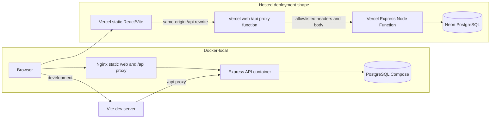
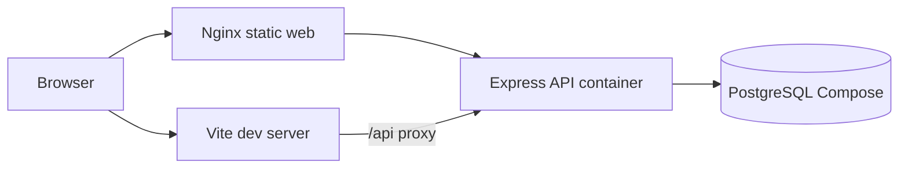
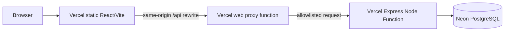

# Architecture

## System shape

The product is a TypeScript modular monolith in npm workspaces. `web/` is a React/Vite single-page application; `api/` is an Express JSON API using Zod validation and Prisma with PostgreSQL. There are no runtime microservices.

The browser talks to the same-origin `/api` path. In local development Vite proxies it to the API listener. In Docker, Nginx serves the built frontend and reverse-proxies `/api/*` to the API container. The hosted projects use a Vercel static frontend plus a small Vercel web proxy function for same-origin `/api/*`, which forwards to a separate Express Node Function; the current hosted database provider is Neon PostgreSQL. The API function entrypoint exports the Express app from `api/index.ts`; `api/src/local-server.ts` starts a local listener.

The request path is: request ID and JSON-size middleware → health/auth/membership/ticket/dashboard router → session and current-membership authorization → role/tenant-scoped service → Prisma/PostgreSQL. Ticket writes use expected versions and transactions that update the ticket and add an immutable activity event together. See [API contract](api.md) and [data model](data-model.md).

## Security boundaries

### Data and tenant boundaries

PostgreSQL stores organizations, global user identities, organization memberships, tickets, comments, immutable activity events, and hashed sessions. Organization identity and role are derived server-side from the authenticated session and current membership. Composite tenant foreign keys constrain ticket requesters/assignees, comment authors, and event actors to the ticket’s organization. They complement request-level authorization; they do not replace it.

The seed creates synthetic Alpha and Beta organizations and local demo accounts. The seeder refuses non-loopback targets and only writes to the local `support_dev` identity. Tests use a separate verified `support_test` identity. Details and exact indexes are in [data model](data-model.md).

## Runtime configuration and security

- Cookie sessions are opaque; the database stores a token hash, expiry, and optional revocation.
- Cookies use HttpOnly and SameSite=Lax; Secure is enabled in production.
- Unsafe auth requests require the configured exact origin and CSRF proof. Membership and authorization are revalidated on requests.
- API JSON bodies are limited to 32 KiB; request schemas reject unknown fields. Errors use a stable safe envelope and request IDs.
- Login throttling is an in-process map with per-account and per-IP windows. It is not shared across function instances; forwarding headers are not trusted because Express proxy trust is disabled. This limitation and required validation are in [limitations](limitations.md).
- The local test database guard checks database identity before mutation. Never point test setup at Preview or Production.

## Local runtime and data flow

The local development and Docker paths use the same browser-facing `/api` contract:

## Docker-local runtime

`docker-compose.yml` runs three services: a loopback-bound PostgreSQL service, an API container, and an Nginx web container. The API waits for database readiness; the web container waits for API readiness. The root `Dockerfile` builds API and web runtime targets from the pinned Node base image. App containers run non-root. The Compose volume persists local databases unless explicitly removed; destructive volume removal is not part of the routine workflow.

For commands and recovery details, see [operations](operations.md).

## Hosted topology (after approval)

The current hosted architecture uses separate Vercel projects for the web and API, plus Neon PostgreSQL. In the Web project, `web/vercel.json` rewrites `/api/*` to `web/api/index.ts`; that handler reconstructs the original API path and `web/src/server/api-proxy.ts` forwards only an allowlist of request/response headers, body, and cookies to validated `API_ORIGIN`. Preview requests add a Vercel OIDC trusted-source token. The API project exports the Express app at `api/index.ts`. Runtime database access uses the provider's pooled URL; Prisma migrations use the separate direct/unpooled `DATABASE_URL_UNPOOLED`. Production remains on Neon.

The repository contains a proposed, unexecuted Supabase Preview migration design at [the migration runbook](supabase-preview-migration.md) and [the availability decision](adr/0005-neon-supabase-availability.md). It does not establish a Supabase project, copy data, change Vercel settings, or validate provider compatibility. Any Supabase Preview must use separate targets and credentials; it cannot replace Production or existing Neon evidence.

Historical deployment and Actions evidence is recorded in [the handoff](../evidence/checkpoints/CURRENT_HANDOFF.md) and [deliverables inventory](../evidence/checkpoints/DELIVERABLES_INVENTORY.md). Provider build statuses are not runtime database-binding evidence. Deployment is optional in the assessment.

## Operations and reliability

| Concern | Current control / limitation |
|---|---|
| Secrets | Local `.env` is ignored; hosted settings hold separate environment secrets. Never put connection strings or private admin credentials in docs. |
| Database URLs | Pooled URL is for runtime; direct/unpooled URL is for controlled migrations. Verify target identity before any migration. |
| Migrations | Versioned Prisma migrations are checked in. Compatibility and rollback need separate evidence; no SQL reverse migration is claimed here. |
| Backups | Hosted restore/PITR procedures require provider-side validation; a local seed is reproducible but is not a backup. |
| Observability | Request IDs and sanitized errors exist; a full monitoring/alerting system is not implemented. |
| Release | Use exact-SHA CI evidence; keep Preview and Production authorization/data separate. |

## Tradeoffs and growth path

A shared PostgreSQL schema and modular monolith keep the assessment system simple to run and inspect. Tenant isolation depends on both authorization scoping and composite database constraints. Capped offset pagination is simpler for the small assessment dataset; deep pages cost more and may need keyset pagination as volume grows. Notifications, attachments, realtime, rich analytics, and observability dashboards are out of scope. Deployment is optional by the assessment. See [limitations and next steps](limitations.md).
