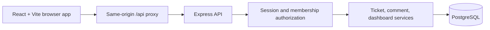
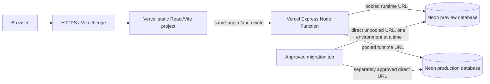

# Architecture

## System shape

The application is a TypeScript modular monolith in an npm workspace. The `web/` workspace is a React/Vite single-page application. The `api/` workspace is an Express JSON API, with Zod request validation and Prisma data access to PostgreSQL. There are no microservices or external runtime dependencies in the mandatory local MVP.

The employer requires a secure multi-tenant support product, an API, persistent data, a usable web interface, test evidence, and a deploy/operations discussion. This project chooses TypeScript, React/Vite, Express, PostgreSQL/Prisma, one shared schema, opaque sessions, membership-based roles, and a same-origin browser API as implementation choices. The detailed boundary and assumptions are in [assumptions](assumptions.md); the data entities and keys are in [data model](data-model.md).

`api/index.ts` exports the Express application for a future serverless function. `api/src/local-server.ts` owns local `listen()` startup. Request handlers validate and normalize input, authorization derives organization and role from a revalidated membership, domain services apply lifecycle and concurrency rules, and Prisma persists mutations and audit events atomically.

## Local runtime and data flow

For local development, the browser dev server proxies `/api` to the API listener. The API connects to the Compose PostgreSQL service through the development role and `support_dev` database. Integration tests use a separate `support_test` role/database and verify its actual identity before database mutation. Compose exposes Postgres only on loopback. The example environment file is copied to the repository-root `.env`; the ignored local file must never be committed or copied into evidence.

An authenticated request resolves the opaque session token to a stored hash, checks expiry/revocation, reloads the current user membership, and builds a request context with the authorized organization and role. Services use that context for all reads and writes. The UI does not supply trusted organization scope. Ticket writes use an expected version and a transaction containing the ticket change and its immutable event; stale versions return `409`.

The local database and application are deliberately separate checkpoints. TK-02 proves PostgreSQL availability and role/database isolation. It does not prove the complete application can run in Compose, schema migrations work, or deterministic tenant seed exists. Those remain unverified until their later tasks and evidence.

## Security boundaries

- Passwords are stored only as adaptive hashes. Session tokens are opaque; only a hash is persisted. Cookie flags are `HttpOnly`, `SameSite=Lax`, and `Secure` in production.
- Unsafe cookie-authenticated requests enforce an approved same-origin check and CSRF defense. Login is rate-limited. Session and membership changes are re-read so expiry, revocation, and role changes take effect.
- Input schemas are role- and operation-specific allowlists. Customers cannot set requester identity; the server derives it from their authenticated membership. Admins and agents may set `requesterUserId` only on ticket creation, and the service verifies an active same-organization `CUSTOMER` membership. Organization, role, password hash, internal version, and audit metadata are never client-controlled.
- Every tenant-owned lookup, relation, filter, search, aggregate, and mutation scopes to the validated organization and role/owner. Cross-organization references fail in service checks and database constraints where practical.
- Unexpected errors are sanitized and carry a request ID. Logs redact credentials, session values, connection URLs, and customer-sensitive content.
- The test database verifier rejects a development or non-loopback target before the test process performs database mutations. No code may reset or clean an unverified database.

## Hosted topology (after approval)

After the mandatory local release gate and separate human approval, the intended hosted shape is two Vercel projects: Vite static frontend and Express Node Function API, with `/api/*` routed to the API and the browser remaining same-origin for session behavior. Neon supplies distinct preview and production databases. Runtime uses the pooled connection URL; migrations use a direct/unpooled URL. Preview and production are never interchangeable.

This describes an intended design only. No project, paid provider resource, domain, secret, database, migration, or deployment is created by this architecture document. Deployment configuration and operations will be validated against current provider behavior in the deployment task, with preview and production authorization kept separate.

The preview and production database edges are separate environments, not simultaneous choices made by one request. The production migration edge is disabled until its distinct approval. The diagram shows target architecture, not provisioned or tested infrastructure.

## Operations and reliability

| Area | Local MVP / intended operational control |
|---|---|
| TLS | Local loopback is development-only. Hosted traffic uses provider TLS; enforce secure cookies and HTTPS redirect/proxy behavior. Verify forwarded-protocol handling instead of trusting arbitrary headers. |
| Secrets | Root `.env` is ignored and local only. Use a secret manager/provider environment settings for hosted credentials; separate preview and production; rotate on exposure. Never print connection strings. |
| Networking | Postgres binds to loopback in Compose. Hosted API access is restricted to the intended database network/authentication path. Do not expose database ports publicly. |
| Backups and restore | Use provider backups/PITR when hosted; document retention and recovery-point objectives, test a restore into an isolated database, then verify row counts and app readiness before switching traffic. Local synthetic data can be recreated. |
| CI/CD | CI installs from the lockfile and runs lint, typecheck, unit/API, DB integration, browser, and build gates. A release is promoted only from a reviewed SHA; secrets are unavailable to untrusted fork workflows. |
| Migrations | Apply versioned migrations once per environment using the direct URL before app traffic depends on a new schema. Prefer expand/contract changes; record the applied migration and a rollback/forward-fix plan. Never run production migrations without approval. |
| Monitoring and alerts | Track API availability/error rate/latency, database connectivity/pool exhaustion, auth throttling, migration failures, and terminal notification failures. Alert on sustained user-visible errors and restore objective breaches; logs use request IDs and omit secrets/content. |
| Rollback | Revert the application to the last reviewed deployment when compatible. For incompatible schema changes, use a forward fix or reviewed restore plan; do not assume a destructive down migration is safe. |
| Cost | Main drivers are database compute/storage/egress, function invocations and duration, build/deployment usage, logs/retention, and backup retention. Start with the smallest suitable tier and review actual usage before scaling. |
| Scale | Bound page size, add tenant-first indexes, inspect representative `EXPLAIN` plans, cap connection pools, and keep request work short. Grow to keyset pagination, read replicas, or background jobs only when measured workload supports it. |

Notification delivery, if introduced, writes an outbox record in the ticket transaction, then retries asynchronously with bounded backoff and idempotency; terminal failures remain inspectable and recoverable. An unavailable provider must not undo a valid ticket mutation. This integration remains unimplemented and is not claimed as tested.

## Tradeoffs and growth path

A single API and shared PostgreSQL schema keep the MVP easy to run and reason about. Tenant IDs and composite relationships reduce accidental cross-org linkage, while server-side membership checks remain the authorization source. This is simpler than separate database-per-tenant or service-per-domain deployments but puts stronger responsibility on query scoping and database integration tests.

Bounded offset pagination and a modest local connection pool are appropriate for a small assessment dataset; they are not a promise of performance at millions of rows. Tenant-first indexes and query plans provide a measurable starting point. At larger scale, keyset pagination, workload-specific indexes, background outbox processing, and separate reporting/read paths can be considered based on observed latency and volume. Each adds operational complexity and should be justified by measurements.
