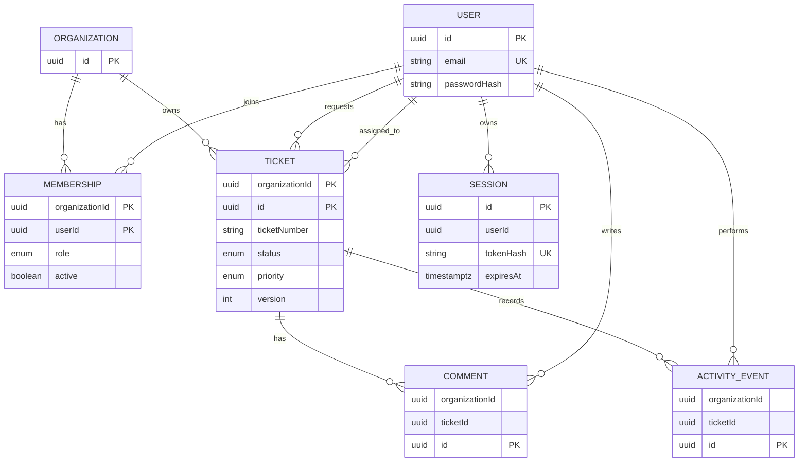

# Data model and query contract

The employer asks for a persistent relational model, organization isolation, a two-organization seed, and a discussion of query scale. The choices below define the intended PostgreSQL model; actual Prisma schema, migrations, and database tests are owned by TK-04 through TK-06 and must agree with this document. This is a design contract, not evidence that those artifacts already exist.

## Entities and relationships

| Entity | Important fields and rules |
|---|---|
| `Organization` | Stable UUID, unique slug, display name, created/updated timestamps. Parent tenant for memberships and tickets. |
| `User` | Stable UUID, normalized unique email, adaptive `passwordHash`, timestamps. A user may join multiple organizations; global identity does not imply a tenant role. |
| `Membership` | `(organizationId, userId)` key, role enum (`ADMIN`, `AGENT`, `CUSTOMER`), active state, timestamps. Each user/org pair has at most one current membership row. Enforce last-active-admin protection in the transaction service. |
| `Ticket` | Tenant ID plus stable UUID, organization-unique ticket number, requester user, nullable assignee user, title/description, status, priority, `dueAt`, version, timestamps. Requester and assignee must have memberships in that same organization. A customer-created ticket uses the authenticated customer as requester; on ticket creation only, an admin or agent may choose a same-org user with an active `CUSTOMER` membership as requester. |
| `Comment` | Tenant ID, ticket ID, author ID, body, created timestamp. Append-only in the MVP; ticket and author must be in the same tenant; no new comments after closure. |
| `ActivityEvent` | Tenant ID, ticket ID, actor ID, event type, sanitized before/after metadata, optional reason, created timestamp. Append-only; tenant-linked to ticket and actor. Insert in the same transaction as the associated mutation. |
| `Session` | User ID, unique token hash, expiry, revocation/last-seen timestamps. Store no raw bearer token; authentication revalidates current membership per request. |

## Tenant integrity

Use organization-scoped unique keys and composite foreign keys so a relationship cannot accidentally pair a ticket in organization X with a user/member in organization Y. At minimum, expose unique `(organizationId, id)` keys for tenant-owned parent rows, reference composite keys from tenant-owned children, and reference `(organizationId, userId)` from requester, assignee, comment author, and event actor. Composite references prove same-organization membership; create-service policy additionally proves customer role for staff-selected requesters. Service methods verify role, ownership, active status, and same-tenant relationships before writes.

All tenant-owned SQL is parameterized and includes the validated `organizationId` in its predicate. The request layer derives that value from current session + membership. Search and dashboard aggregation cannot bypass the tenant predicate. Database constraints protect referential integrity; they do not replace application authorization.

## Constraints and indexes

Expected constraints to realize in Prisma/SQL and verify against PostgreSQL:

- Unique normalized `User.email`, `Organization.slug`, `(Membership.organizationId, Membership.userId)`, and `(Ticket.organizationId, Ticket.ticketNumber)`.
- Composite tenant foreign keys for ticket requester/assignee, comment ticket/author, and event ticket/actor.
- Check or enum constraints for allowed role/status/priority values; positive ticket version; non-empty required names/title/body where suitable.
- Unique session token hash and foreign key to its user; session token hash is never returned to the browser.
- No `UPDATE`/`DELETE` service path for comments or activity events. The database writer is restricted to application-owned tables and migration authority remains separate in hosted environments.

Initial indexes should follow the tenant-leading predicates:

| Table | Index |
|---|---|
| `Membership` | Primary/unique `(organizationId, userId)`; reverse lookup `(userId, active, organizationId)` |
| `Ticket` | Unique `(organizationId, ticketNumber)`; listing `(organizationId, createdAt DESC, id DESC)`; status/priority `(organizationId, status, priority, createdAt DESC, id DESC)` |
| `Ticket` | Assignee workload `(organizationId, assigneeId, status, createdAt DESC, id DESC)`; requester ownership `(organizationId, requesterId, createdAt DESC, id DESC)`; overdue `(organizationId, dueAt, status)` where a useful partial predicate is supported |
| `Comment` | `(organizationId, ticketId, createdAt, id)` |
| `ActivityEvent` | `(organizationId, ticketId, createdAt, id)` |
| `Session` | Unique `(tokenHash)`; lookup/cleanup `(userId, expiresAt)` and expiry index if cleanup query needs it |

Index order will be adjusted from real query plans. Avoid duplicate indexes created solely because they are listed here; capture the final migration definitions and representative `EXPLAIN` output in release evidence.

## Query and scale behavior

Ticket list endpoints require validated tenant scope, a deterministic order of `createdAt DESC, id DESC`, a bounded page size, and filters limited to status, priority, assignee, requester, and bounded text search. The MVP uses capped offset pagination with a documented maximum. A cursor over `(createdAt, id)` is the growth path when deep-page latency is observed. Dashboard queries use one UTC evaluation instant and the definitions in [assumptions](assumptions.md).

The assessment mentions millions of tickets as a scale discussion. This model does not claim that scale has been load-tested. Before a release claim, measure representative list/search/workload queries with seeded data and inspect `EXPLAIN (ANALYZE, BUFFERS)` on a safe local database. Apply indexes based on query predicates and selectivity; monitor slow queries, pool saturation, storage growth, and migration duration. For larger workloads, keyset pagination and a read/reporting path may be justified, with additional consistency and operational costs.
