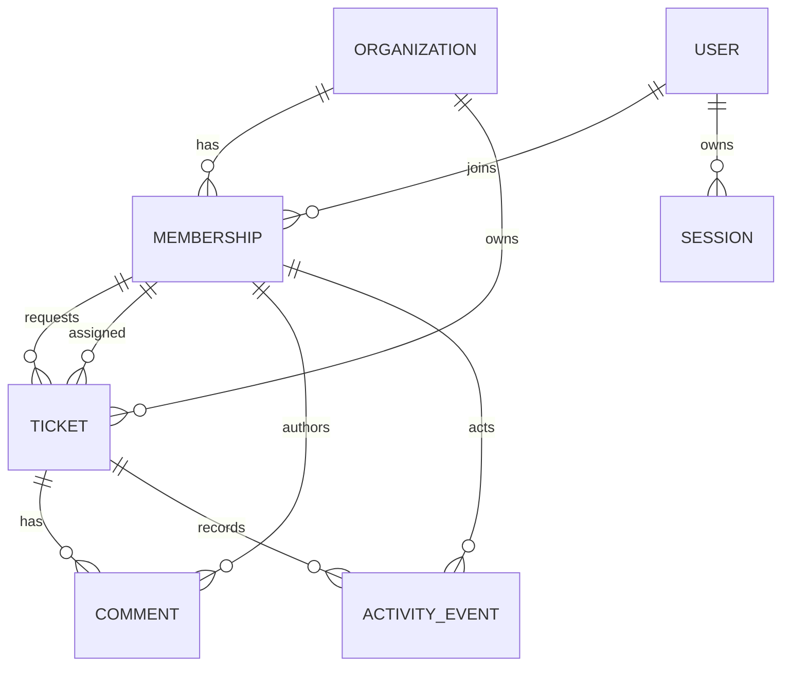

# Data model and key indexes

This document describes the checked-in Prisma schema and migrations, not a future design. Source of truth: `api/prisma/schema.prisma` and the three checked-in migrations under `api/prisma/migrations/`.

## Entities and relationships

- **Organization**: UUID primary key; unique slug; display name and timestamps.
- **User**: UUID primary key; unique normalized email, password hash, timestamps. User identity is global; roles live on memberships.
- **Membership**: `(organizationId, userId)` composite primary key; role enum `ADMIN | AGENT | CUSTOMER`, active flag, timestamps. A user may belong to several organizations.
- **Ticket**: UUID primary key; organization, positive organization-local ticket number, requester membership, optional assignee membership, title, description, status, priority, optional due time, optimistic version, timestamps. Unique `(organizationId, id)` supports tenant-scoped child foreign keys; unique `(organizationId, ticketNumber)` makes ticket numbering organization-local.
- **Comment**: UUID, organization and ticket IDs, author membership, body, creation time. API behavior treats comments as append-only.
- **ActivityEvent**: UUID, organization and ticket IDs, actor membership, event type, optional JSON before/after values, optional reason, creation time. Ticket mutation and its activity insert are performed in one transaction. API behavior is append-only; no database trigger claims immutability.
- **Session**: UUID, user ID, unique hash of opaque session token, expiry, optional revocation/last-seen timestamps and created timestamp. Raw session tokens are not stored in this table.

## Tenant integrity and constraints

Foreign keys use the composite `(organizationId, userId)` membership key for ticket requester/assignee, comment author, and activity actor. Comment and activity ticket relationships use `(organizationId, ticketId)` to a ticket's unique `(organizationId, id)`. The migration has explicit checks that `ticketNumber > 0`, `version > 0`, and assignee columns are either both null or both present with assignee organization equal to ticket organization. The user email check requires a normalized, non-empty value. Enum types constrain roles, ticket statuses/priorities, and activity types.

These constraints prevent cross-organization references in the relational graph. The API still must check caller authorization, ownership, active membership, and operation-specific permission; database constraints do not prove those policies.

## Key indexes in Prisma/migrations

| Table | Index / key | Purpose |
|---|---|---|
| Organization | `Organization_slug_key` unique (`slug`) | Resolve tenant slug. |
| User | `User_email_key` unique (`email`) | Resolve normalized login. |
| Membership | `Membership_pkey` (`organizationId, userId`) | Membership lookup and FK target. |
| Membership | `Membership_userId_isActive_organizationId_idx` (`userId, isActive, organizationId`) | List active organizations for a user. |
| Ticket | `Ticket_organizationId_ticketNumber_key` unique (`organizationId, ticketNumber`) | Tenant-local numbering. |
| Ticket | `Ticket_org_created_id_idx` (`organizationId, createdAt DESC, id DESC`) | Default tenant list order. |
| Ticket | `Ticket_org_status_created_id_idx` (`organizationId, status, createdAt DESC, id DESC`) | Status-filtered listing. |
| Ticket | `Ticket_org_priority_created_id_idx` (`organizationId, priority, createdAt DESC, id DESC`) | Priority-filtered listing. |
| Ticket | `Ticket_org_requester_status_created_id_idx` (`organizationId, requesterUserId, status, createdAt DESC, id DESC`) | Customer-owned filtering. |
| Ticket | `Ticket_org_assignee_status_created_id_idx` (`organizationId, assigneeUserId, status, createdAt DESC, id DESC`) | Agent workload filtering. |
| Ticket | `Ticket_org_due_status_idx` (`organizationId, dueAt, status`) | Due/overdue dashboard calculation. |
| Comment | `Comment_org_ticket_created_id_idx` (`organizationId, ticketId, createdAt DESC, id DESC`) | Tenant-scoped conversation paging. |
| ActivityEvent | `ActivityEvent_org_ticket_created_id_idx` (`organizationId, ticketId, createdAt DESC, id DESC`) | Tenant-scoped history paging. |
| Session | `Session_tokenHash_key` unique (`tokenHash`); `Session_userId_expiresAt_idx` (`userId, expiresAt`) | Session lookup and user expiry management. |

Additional unique indexes `Ticket_organizationId_id_key`, `Comment_organizationId_id_key`, and `ActivityEvent_organizationId_id_key` support tenant-composite child references. The Prisma schema names all indexes; confirm exact deployed state with migration status rather than assuming documentation proves a database was migrated.

## Query and pagination tradeoffs

Ticket lists filter by validated organization, role/owner, status, priority, assignment, and bounded text search. The API uses capped offset pagination: at most 1,000 pages and 100 rows per page, so no page returns beyond the first 100,000 matching rows. This is simple and deterministic for the assessment but deep offsets can become expensive. Keyset pagination on `(createdAt, id)` is the growth path. Dashboard and list query plan evidence is scoped to the recorded local PostgreSQL dataset in [performance](performance.md); it is not a large-scale load test.
