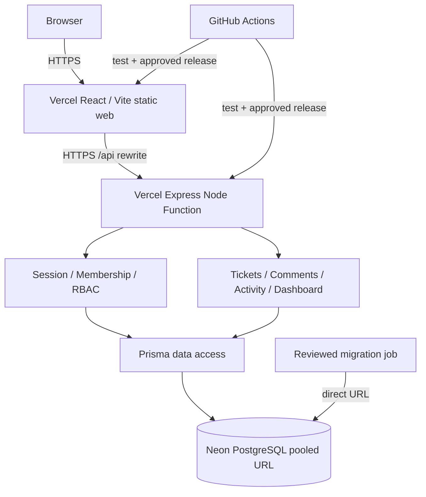

# Multi-Tenant Customer Support Platform — End-to-End Engineering Delivery Plan

**Source of truth:** `reference/assessment.pdf` (3 pages, Full Stack Engineer — Product Development Assessment).  
**Status:** Planning / not implemented.  
**Timebox:** 2–3 days suggested by assessment, with a 60–90-minute review.  
**Strategy:** Secure, documented vertical slice first; stretch capabilities only after release gates pass.  
**Working model:** Codex Desktop (primary orchestrator) + `obra/superpowers` skills + deterministic local/CI harness + independent agent reviews.

## 0. Definition of done (release invariant)

The extended build is **READY_FOR_REVIEW** only when all applicable items are true; **LOCAL_MVP_READY** is allowed after C0–C5 + mandatory PDF deliverables pass even if optional C6 hosting is not undertaken:

1. A clean clone can install and run the local app and PostgreSQL with documented commands, using Docker Compose.
2. At least two seeded organizations and admin/agent/customer identities exist; sample login is safe, reproducible and documented.
3. Login, tenant membership/role enforcement, ticket create/list/filter/detail/update, comments, activity trail, assignment, and minimal dashboard work end to end.
4. Every read/write of org-owned data is constrained by a server-validated tenant context and fine-grained permissions. Hostile tests demonstrate denial of cross-org and cross-customer access.
5. All required backend/front-end tests, lint, typecheck, build, migration, and Playwright smoke tests pass on the exact submitted commit.
6. Input validation, consistent errors, request logging/redaction, conflict detection, and non-happy-path UI states are demonstrated.
7. Docs include architecture, data model/indexes, API contract/examples, test results, seed credentials/instructions, tradeoffs/gaps, operations and scaling.
8. For the **extended deployed-release target**, a separately approved Vercel + Neon deployment works over HTTPS using synthetic demo data with verified health, migrations and rollback plan. **Local MVP readiness never requires the optional hosted release**.
9. Independent specification, security, code-quality, UX/accessibility, and operations reviews find no unmitigated P0/P1 defect.
10. A 5–7 minute live demo and 60–90 minute review drill are prepared, including evidence and explicit AI-assisted work disclosure.

**Cannot claim completion** from an agent summary, passing unit tests alone, or a deployment URL alone. Attach exact commit SHA, command, exit code and log/evidence path.

> Updated for **Codex Desktop + Superpowers**, two **Vercel** projects, and **Neon PostgreSQL**. Read `harness/VERCEL_NEON_DEPLOYMENT.md` before C6. Source PDF is authoritative; other details are proposed assumptions.

## 1. Requirements precedence and scope

Priority of authority: (1) assessment PDF, (2) signed-off design, (3) this delivery plan, (4) task plans, (5) code. If they conflict, stop and log a decision; never silently change the assessment.

### P0 — Working release (mandatory)
- Authentication; membership and role-scoped authorization; organization isolation on *every* server endpoint.
- Customer creates/views/comments on own tickets; agent works authorized org tickets; admin can view org tickets and manage memberships/roles.
- Tickets: create, list, detail, edit, status transitions, priorities, assignments, close/reopen as allowed.
- Search, status/priority/assignee/customer filters, pagination, stable sorting.
- Comments and durable, meaningful activity events; persisted in PostgreSQL.
- Dashboard: status/priority counts, overdue tickets, agent workload with explicit formulas.
- Usable React pages: sign-in, ticket list, ticket details, new ticket, dashboard; responsive with loading/empty/error/403 states, validation and keyboard navigation.
- Local Docker Compose, seeded 2-org data, automated tests, docs and a cloud architecture diagram.

### P1 — Shipping-quality enhancements within timebox
- Optimistic concurrency with `version` + HTTP 409; atomic ticket update and audit event.
- Protected same-origin session cookie and CSRF/origin mitigation, no tokens in localStorage.
- Rate limiting, strict Zod validation, response-field allowlisting, security headers, structured logging/correlation ID.
- CI on each PR, reproducible deployment, smoke tests, rollback/runbook, clean-clone setup.

### P2 — Document/implement only if P0 and P1 have passed
- Assignment notifications, attachments, rich analytics, search tuning, advanced observability, multiple environment previews.

## 2. Design assumptions (must appear in `docs/assumptions.md`)

- **Architecture:** modular monolith, TypeScript everywhere, REST JSON under `/api`, React/Vite deployed as a separate Vercel static project with same-origin browser `/api/*` rewrite to Express Node Function; background jobs deferred.
- **Stack:** React + Vite, Tailwind, TanStack Query, React Router; Node + Express, Zod, Prisma; PostgreSQL; Vitest/Supertest, Playwright; Docker Compose; GitHub Actions.
- **Tenant model:** shared database, `organization_id` on organization-owned tables; org selection tied to a server-verified membership. User may have memberships in >1 org but acts within one verified active org at a time.
- **Roles:** ADMIN, AGENT, CUSTOMER per membership (not a global user role). No public self-signup. Demo users are seeded. Admin can add and change memberships; prevent demotion of last admin.
- **Visibility:** admin sees all org tickets; agent sees all tickets within their org (document this as the permitted-agent policy); customer sees only tickets they created.
- **Ticket states:** OPEN -> IN_PROGRESS -> RESOLVED -> CLOSED; RESOLVED -> IN_PROGRESS (reopen); OPEN -> RESOLVED allowed for quick resolution; CLOSED is read-only/final in MVP. Only agent/admin change state/priority/assignee, customer can comment while not CLOSED. State transition validation is central, not duplicated across UI/API.
- **Priority:** LOW, MEDIUM, HIGH, URGENT. Default MEDIUM. Define due dates at ticket creation by urgency (e.g. 96h/72h/24h/4h); document this as illustrative SLA, not a requirement from the PDF.
- **Dashboard:** `overdue = due_at < now AND status NOT IN (RESOLVED, CLOSED)`; workload = count of OPEN/IN_PROGRESS assigned tickets per agent; metrics scoped to org. Counts grouped by status/priority; record exact query logic in docs.
- **Pagination:** deterministic `createdAt DESC, id DESC`; bounded page size (e.g. default 20, maximum 100), allow offset at MVP; explain keyset cursor option at scale.
- **Comments:** agent/admin/customer may comment only if eligible to see ticket and state permits. Change events immutable and written in same transaction as ticket updates.
- **Duplicate submissions:** MVP supports `Idempotency-Key` for ticket create when practical; otherwise explicitly log as limitation and document deterministic handling. No double audit events on a retry.
- **Concurrent edits:** compare-and-swap ticket `version` in a transaction; one edit wins, stale update returns 409 with a refresh flow. Do not use last-write-wins silently.
- **Authentication:** hashed passwords, persistent server-side sessions with opaque cookie; `HttpOnly; Secure` in production and `SameSite=Lax`, CSRF/origin guard on unsafe requests; short expiry, logout invalidation, login rate limit.
- **Deployment:** primary path is two Vercel monorepo projects (Vite `web/` frontend + Express `api/` Node.js Function) and Neon PostgreSQL; local Docker PostgreSQL remains required. Cloud alternative AWS design is documented; live AWS deployment is not required.
- **Data:** fake seeded demo customers/tickets only. No real private customer data or live credentials in repository, screenshots or logs.

## 3. System architecture and data design

### Architecture



Keep all organization authorization on the server; user-controlled tenant IDs are never authoritative.

### Entities / constraints

- `Organization(id, slug UNIQUE, name, createdAt)`.
- `User(id, email UNIQUE, passwordHash, active, createdAt)`.
- `Membership(id, organizationId, userId, role, createdAt, UNIQUE(organizationId,userId))`.
- `Session(id, userId, tokenHash UNIQUE, expiresAt, revokedAt)` (opaque cookie; server-side store).
- `Ticket(id, organizationId, number, customerId, assigneeId?, title, description, status, priority, dueAt, version, createdAt, updatedAt, UNIQUE(organizationId,number))`.
- `Comment(id, organizationId, ticketId, authorId, body, createdAt)`.
- `ActivityEvent(id, organizationId, ticketId, actorId, type, beforeJson?, afterJson?, createdAt)`.
- `IdempotencyRecord(organizationId, actorId, key, route, requestHash, responseRef, createdAt, UNIQUE(organizationId,actorId,route,key))` optional P1.

Crucial: schema-level composite foreign keys should prevent cross-organization linkage, e.g. ticket `(organizationId, assigneeId)` references membership `(organizationId, userId)` where supported; application role checks remain required. Validate nullable-assignee semantics. Non-tenant `User`/`Session` queries only occur in auth flow and must not leak org data.

### Indexes and query shape

- `Ticket(organizationId, createdAt DESC, id DESC)` for stable tenant list.
- `Ticket(organizationId, status, createdAt DESC, id DESC)`; analogous scoped priority/assignee/customer indexes based on actual query plans.
- `Comment(organizationId, ticketId, createdAt, id)`; `ActivityEvent(organizationId, ticketId, createdAt, id)`.
- `Membership(organizationId, userId)` UNIQUE and `(userId,organizationId)` for login/membership lookups.
- Search MVP: bounded tenant-scoped `ILIKE` query, with stated scalability limitation. At millions of tickets, add PostgreSQL full-text/GIN or trigram indexes, cursor pagination, stats and EXPLAIN ANALYZE on representative filters; avoid unbounded wildcard scans.

### Permissions matrix

| Action | Admin | Agent | Customer |
|---|---|---|---|
| View org dashboard | Yes | Yes (permitted org) | No |
| Manage organization memberships/roles | Yes (cannot remove last admin) | No | No |
| Create ticket | Yes | Yes | Yes |
| Read any ticket in own organization | Yes | Yes | No |
| Read own ticket | Yes | Yes | Yes |
| Edit ticket title/description | Yes | Yes | Own ticket only if OPEN (assumption) |
| Change status, priority, assignee | Yes | Yes | No |
| Comment on visible non-CLOSED ticket | Yes | Yes | Yes |
| Read cross-org records or act cross-org | Never | Never | Never |

Test both cross-organization denial and same-organization customer ownership denial; one does not imply the other.

## 4. API contract (document payloads and errors in `docs/api.md`)

| Method | Route | Access | Notes |
|---|---|---|---|
| POST | `/api/auth/login` | Public | Rate limit, credential validation, secure session cookie |
| POST | `/api/auth/logout` | Authenticated | Revoke session, clear cookie |
| GET | `/api/auth/me` | Authenticated | User and valid memberships, no secrets |
| GET | `/api/memberships` | Admin | Tenant-scoped roster |
| POST/PATCH | `/api/memberships[/:id]` | Admin | Enforce org and last-admin rule |
| GET | `/api/tickets` | Org member | status, priority, assigneeId, customerId, q, sort, page/cursor |
| POST | `/api/tickets` | Org member | Create ticket, customer ownership, optional idempotency key |
| GET | `/api/tickets/:id` | Authorized owner/agent/admin | Hide foreign/nonowned with 404 |
| PATCH | `/api/tickets/:id` | Role/ownership policy | Zod allowlist; version precondition |
| PATCH | `/api/tickets/:id/assignment` | Agent/Admin | Target member belongs to active org and has agent/admin role |
| GET/POST | `/api/tickets/:id/comments` | Ticket viewer | Permission checks and stable order |
| GET | `/api/tickets/:id/events` | Ticket viewer | Immutable audit trail |
| GET | `/api/dashboard` | Admin/Agent | Tenant-scoped stats and due criteria |
| GET | `/healthz` | Public | Liveness (no secrets) |
| GET | `/readyz` | Runtime | Readiness / DB dependency, no secrets |

For production responses: 400 invalid syntax, 401 unauthenticated, 403 insufficient *role for resource class*, 404 hidden resource or absent, 409 version/idempotency conflict, 422 semantic invalid state transitions if standardized, 429 throttle, 500 sanitized unexpected error. Pick and document one uniform shape: `{error: {code, message, requestId, details?}}`.

## 5. Execution phases (each is a narrow Superpowers task plan with tests before code)

### C0 — Bootstrap and baseline [target 1–2 hours]
**Skills:** `using-superpowers`, `brainstorming`, `using-git-worktrees`, `writing-plans`.

Tasks:
1. Install Superpowers in Codex Desktop and verify skill discovery in fresh session.
2. New Git repo + `main`, clean status, assessment PDF placed under `reference/`.
3. Commit `AGENTS.md`, this plan, assumptions, acceptances; set nonnegotiable scope.
4. Bootstrap npm workspace (`web/`, `api/`); pin Node version, lockfile, scripts.
5. Docker Compose PostgreSQL with healthcheck; separate test DB; `.env.example`; `.gitignore`.
6. `npm ci`, `npm run typecheck`, `npm run test`, `npm run build`, `docker compose up` reproducibility baseline.
7. `docs/superpowers/specs/...` signed-off design; `docs/superpowers/plans/...` tiny task-by-task plan.

**Exit:** clean-clone setup works; repository guardrails visible; no implementation begins without an approved design and executable acceptance list.

### C1 — Domain schema and security policy [2–3 hours]
**Skills:** `writing-plans`, `test-driven-development`, `subagent-driven-development`, `requesting-code-review`.

Tasks:
1. Define role matrix, ticket state graph, due/SLA math and API contracts.
2. Model Prisma schema, constraints, migrations and tenant-scoped index strategy.
3. Implement deterministic seed (two orgs, 6 accounts minimum, ticket/comment fixtures).
4. DB-level tests for membership uniqueness, missing foreign references and cross-org assignment rejection.
5. Security review independently checks org ownership on every relationship.

**Exit:** migration + seed can run twice safely and recreate equivalent fixture state; isolated organization relationships are enforced.

### C2 — Authentication and authorization [2–3 hours]
**Skills:** `test-driven-development`, `systematic-debugging`, `verification-before-completion`.

Tasks:
1. Test login success/failure, logout invalidation, expired session, missing session and throttling.
2. Build session auth and middleware that loads verified membership for the active organization.
3. Centralize policy checks; never accept the raw client orgId as authority.
4. Tenant A/B fixture attack suite: swap cookies and IDs; deny cross-org read, write, comments, dashboard and membership routes.
5. Test same-org customer requesting another customer's records; test role escalation and mass assignment payloads.

**Exit:** no cross-org or cross-customer exposure across existing endpoints; all forbidden actions have proper statuses.

### C3 — Ticket, comments, events, dashboard [3–5 hours]
**Skills:** `subagent-driven-development`, `test-driven-development`, `requesting-code-review`.

Tasks:
1. Ticket create, list, filter, search, pagination and stable sort with query validation.
2. Details, update, state/priority change and valid assignment; preserve audit events atomically.
3. Comment creation/list with correct ticket visibility.
4. Ticket `version` conflict path; stale update -> 409; no duplicate audit events.
5. Dashboard grouped counts, overdue dueAt and workload with tenant isolation.
6. Duplicate create handling or documented idempotency gap; tests for retry semantics if implemented.

**Exit:** all workflows execute from HTTP tests against real PostgreSQL; concurrency regression test passes.

### C4 — React product [3–5 hours]
**Skills:** `brainstorming` for UX if needed, `test-driven-development`, `subagent-driven-development`.

Tasks:
1. Authenticated router, login/logout, session revalidation, 403/404 fallback.
2. Ticket list with filters, search, pagination, stable empty/loading/error states.
3. Ticket create and detail, activity/comments, status/priority/assignment controls by role.
4. Admin minimal membership roster and role editing; dashboard counts and workload.
5. TanStack Query for server state; small local form state; avoid excess global stores.
6. Accessible labels, focus visible, keyboard operation, usable mobile layout, no optimistic mutation unless conflict recovery is defined.
7. Playwright journeys for 3 roles and two orgs; screenshot/DOM accessibility checks on primary pages.

**Exit:** all roles complete authorized workflows in browser, visual/error states verified at mobile+desktop sizes.

### C5 — Security, resilience and scale proof [2–3 hours]
**Skills:** `requesting-code-review`, `systematic-debugging`, `verification-before-completion`.

Tasks:
1. Run negative/abuse suite: ID swapping, unauthorized assignment, body pollution, XSS strings, invalid filters, CSRF case, wrong method, expired cookie, brute-force limits.
2. Test simultaneous updates and network retries; document error recovery.
3. Instrument requestId, masked logs, error boundary, health/readiness, query timing.
4. Seed 10k tickets (optional local stress fixture), run representative `EXPLAIN ANALYZE`, check stable pagination.
5. Dependency audit and secret scan; fix P0/P1 and document accepted P2.
6. Write architecture, schema/indexes, API examples, scaling tradeoffs and limitations.

**Exit:** CI and release suite green, 0 P0/P1 known defects, no secrets; metrics formulas and scaling limits documented.

### C6 — Production deployment [1–3 hours, optional per PDF]
**Skills:** `writing-plans`, `verification-before-completion`, `requesting-code-review`.

**Preferred topology:** two Vercel projects from this monorepo (`web/` Vite static frontend and `api/` Express Node.js Function), with frontend `/api/*` rewrites and an isolated Neon PostgreSQL database. Verify rewritten HTTPS requests, cookies, CSRF/origin checks, and function region. Keep local Docker Compose PostgreSQL. Document AWS alternative: S3+CloudFront frontend, ECS/Fargate API, RDS PostgreSQL, Secrets Manager, CloudWatch and TLS.

Runbook:
1. Freeze exact tested Git SHA. Confirm build in clean checkout using pinned runtime.
2. Create separately approved Vercel frontend/API projects and Neon preview database branch; align function and Neon regions where available, use encrypted TLS connections; set secrets via dashboard/integration, never in git.
3. Review actual provider plans, billing, retention, and backup before provisioning.
4. Apply `prisma migrate deploy` once through a reviewed job using Neon **direct/unpooled** connection; application runtime uses pooled Neon URL. Do not run migrations during every Vercel build or function invocation.
5. Deploy Express as a **single Vercel Node.js Function** from `api/` and Vite static assets from `web/`; test frontend rewrites, SPA fallback, `/api` routing, TLS, secure cookies, CSRF/origin and browser refresh.
6. Smoke on deployed URL: login, role matrix, create/edit/comment, dashboard refresh, forbidden tenant swap, 409 concurrency.
7. Confirm CI SHA == deployed SHA. Inspect sanitized logs, readiness, 404 SPA routing, redirects/TLS, cookie flags and secret redaction.
8. Record a rollback rehearsal of code deploy; use backward-compatible migration strategy and nonproduction backup/restore drill. Database rollback is not assumed to happen automatically with code rollback.
9. Freeze published release; do not switch auto-deploy on without explicit agreement.

**Exit:** verified HTTPS app + smoke evidence + migration/backup/rollback runbook. If deployment blocked by credentials, costs or permissions, mark `DEPLOYMENT_BLOCKED` and deliver fully working Docker-local release (do not falsely claim deployed).

### C7 — Independent adversarial final review [1–2 hours]
**Skills:** `requesting-code-review`, `receiving-code-review`, `verification-before-completion`.

Dispatch fresh isolated reviewer agents:
- **Product/spec reviewer:** independently map every requirement to code and tests; no blanket 'looks done'.
- **Security reviewer:** auth, session, tenant escape, IDOR, role property-level checks, race conditions, audit tampering, secrets.
- **Backend/DB reviewer:** indexes, transactions, concurrency, idempotency, pagination, migration, API consistency.
- **Frontend/UX reviewer:** responsive, keyboard/tab order, form validation, loading/empty/403/404/500 and stale UI.
- **SRE reviewer:** Docker clean install, health, CI, deployment, logs, backups, rollback and cost drivers.

Report P0/P1/P2 with exact file/line and a reproducer, evidence of success/failure, owner, and retest. Fix P0/P1 with fresh regression tests, rerun release suite and re-review the exact SHA. Never invent a clean review.

**Exit:** `REVIEW_READY` only after independently replayed success and signed evidence.

### C8 — Submission and presentation [1 hour]
- Repository URL, reviewed tag/SHA, deployment URL if proven, setup/run commands.
- README quick start + demo logins (only dedicated demo users); `docs/architecture.md`, `docs/data-model.md`, `docs/api.md`, `docs/limitations.md`, `docs/testing.md`, `docs/operations.md`.
- `evidence/releases/release-evidence.md`: commands, CI URL, SHA, smoke log, coverage summary, open issues.
- Honest `AI_USAGE.md`: what was personally designed/reviewed, what tools generated, what was reused, and what was verified independently.
- 5–7-minute demo: login as two orgs, create ticket, assign/comment/resolve, dashboard change, deliberate cross-tenant denial, stale edit conflict.
- Review practice: why modular monolith, tenant policy, indexes, million-row growth, failed integration strategy, outages and release rollback.

## 6. Agent harness contract

See `harness/AGENT_HARNESS.md` for detailed orchestration. Minimum rules:
- Orchestrator reads PDF + plan + AGENTS.md + acceptance matrix before planning.
- Store approved design in `docs/superpowers/specs/` and implementation plans in `docs/superpowers/plans/`.
- Per change: failing test -> minimal implementation -> passing test -> quality check -> commit -> spec review -> code review.
- Fresh implementer and reviewers receive only relevant precise context, no implicit recollection.
- Independent parallel work only with ownership boundaries; use git worktrees, never shared-file concurrent edits.
- Pause on destructive operations, schema reset in non-test DB, unknown paid billing, production credentials, release/merge decisions.
- Deterministic acceptance scripts are the authority; agent approval alone never overrides failure.
- Capture provenance of every PR/commit/evidence run.

## 7. CI gate definitions

`G0` preflight: clean clone, install, formatting, lint, typecheck.  
`G1` database: migrations apply in empty PG; seed reproducible, constraints correct.  
`G2` security: isolation/role/ownership negative matrix passes.  
`G3` functionality: all ticket, comment, activity, dashboard API tests pass.  
`G4` user journeys: desktop/mobile browser suite with empty/error/permission states passes.  
`G5` release: production build, health/readiness, no high-severity open findings, no committed secrets.  
`G6` optional deployed release: approved Vercel + Neon HTTPS smoke against exact release SHA and a documented rollback path.  
`G7` independent final review: all P0/P1 findings closed, known limitations explicit; review local-only target honestly when G6 is optional and not performed.

Suggested root scripts: `npm run check`, `npm run test:api`, `npm run test:web`, `npm run test:e2e`, `npm run db:migrate`, `npm run db:seed`, `npm run build`, `npm run release:verify`. The implementation agent must make the commands real, not leave decorative or passing no-op scripts.

## 8. Failure, timeout, and escalation policy

- Test failed: invoke systematic debugging, record reproduction and root cause; write red regression before changing code.
- Missing Docker/unsupported OS: run equivalent managed Linux CI; local skip cannot count as passing.
- External provider outage: do not change app correctness to hide 503/5xx; record environment and retry only bounded, classify failure.
- Context exhausted: commit a handoff with branch, SHA, full status, task completed, next failing test, evidence path; restart fresh harness context.
- No unapproved reset, clean, force push, merge, deleting worktrees or destructive database operations.
- No agents promising to continue later on their own: each run ends with current state and next executable step.

## 9. Evidence/reporting template for every checkpoint

```
Checkpoint: C# / descriptive name
Branch / HEAD SHA:
Modified files:
Requirement IDs covered:
RED test and failure proof:
GREEN commands + exit codes:
Security/role-negative tests:
Spec review verdict and evidence:
Code-quality review verdict and evidence:
Known risks (severity):
Next checkpoint dependency:
```

## 10. Priority/timebox reality check

Use two execution tracks:

**Track A (assessment deadline, 2–3 days):** C0 → C1 → C2 → C3 → C4 → essential C5 → C8, then C6/C7 if time remains. The must-pass deliverable is a secure Docker-local vertical slice with clean documentation and explainable decisions.

**Track B (preferred portfolio/review-ready quality):** complete all C0–C8 including deployment, CI, adversarial review and operational drill. This may exceed the assessment's suggested timebox depending on environment and agent performance. Record any departure honestly, never silently expand scope.

### Sources
- User-provided `reference/assessment.pdf`, pp. 1–3 (primary contract).
- Superpowers: https://github.com/obra/superpowers (skill names and workflows).
- Vercel Express: https://vercel.com/docs/frameworks/backend/express; Vercel monorepos: https://vercel.com/docs/monorepos; Neon Prisma: https://neon.com/docs/guides/prisma; managed Neon branching/backup: https://neon.com/docs/ .
- OWASP API security: https://api-security.owasp.org/editions/2023/en/0x11-t10/.
